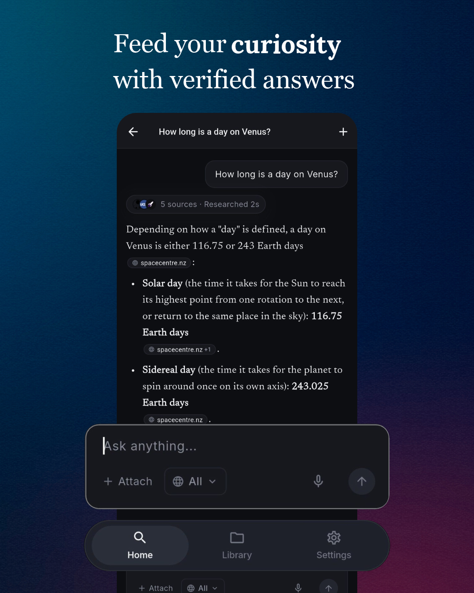
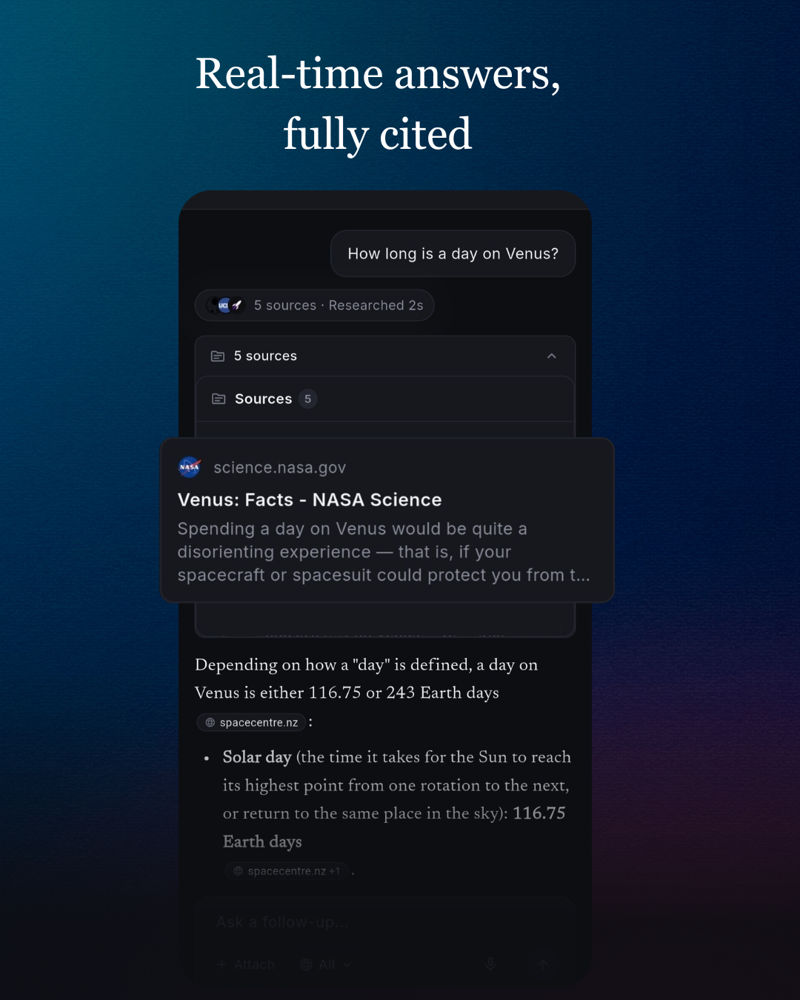
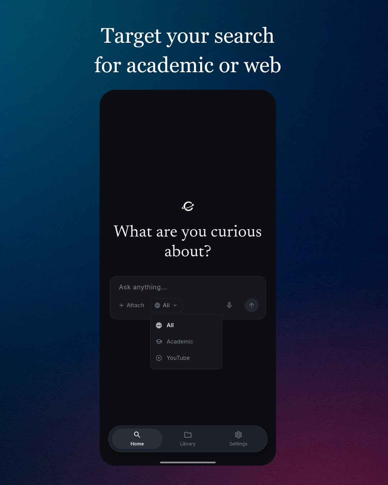
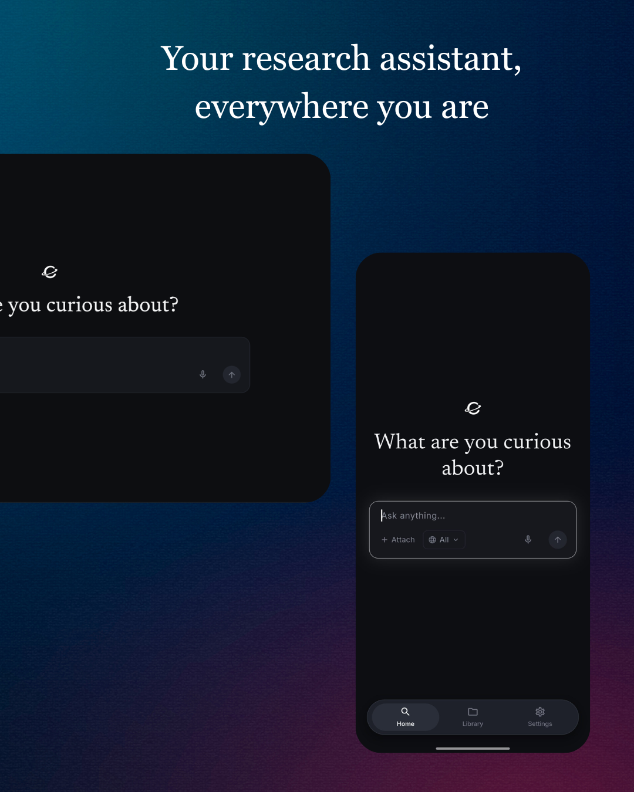

# Curiosity

**Where knowledge begins.** A cross-platform AI research assistant that searches the live web, reads the sources, and streams cited answers in real time.

Curiosity pairs a Flutter client with a FastAPI WebSocket backend. Every question is rewritten into a standalone search query, grounded in freshly scraped web pages, and answered by Gemini with inline, verifiable citations that link back to the exact source.

**Live demo:** [curiosity.namiramohab.workers.dev](https://curiosity.namiramohab.workers.dev/)

> **Availability note:** The demo frontend is hosted on Cloudflare. The backend currently runs on a temporary free-tier instance, so the demo may be offline at times. If answers fail to load, run the backend locally by following [Getting Started](#getting-started) or see [Live Demo and Hosting](#live-demo-and-hosting).

> **Status:** Active development. The WebSocket protocol and project layout are stable; UI details may change between releases.

---

## Table of Contents

- [Key Features](#key-features)
- [Visual Showcase](#visual-showcase)
- [Tech Stack](#tech-stack)
- [System Architecture and Data Flow](#system-architecture-and-data-flow)
- [WebSocket Protocol](#websocket-protocol)
- [Getting Started](#getting-started)
- [Live Demo and Hosting](#live-demo-and-hosting)
- [Project Structure](#project-structure)
- [Troubleshooting](#troubleshooting)
- [Contributing](#contributing)
- [License](#license)

---

## Key Features

### Retrieval and Answer Pipeline

| Capability | Description |
| --- | --- |
| **Real-time streaming** | Bidirectional streaming over a single WebSocket (`/ws/chat`). Search results, answer tokens, related questions, and completion events arrive as discrete typed messages. |
| **Context-aware query rewriting** | Follow-up questions are rewritten by Gemini into standalone search queries using the recent conversation history, so "what about its cost?" searches correctly. |
| **Live web search and scraping** | Tavily provides fresh search results. Pages are fetched in parallel with `httpx` and cleaned with `trafilatura` to strip ads, navigation, and comments. If a page cannot be scraped, the Tavily snippet is used as a fallback. |
| **Search focus modes** | **All** for broad web search, **Academic** (ArXiv, Google Scholar, ResearchGate, PubMed/NCBI, JSTOR, ScienceDirect, Springer, IEEE), and **YouTube**. |
| **Grounded, cited answers** | The model is instructed to answer only from the numbered sources and to cite every claim as `[n]`. Source text is treated as data, never as instructions. |
| **Related questions** | Three follow-up questions are generated after every answer and rendered as one-tap chips. |
| **Resilient model handling** | Multi-model fallback with automatic rollover protects against 503 and 429 spikes and deprecated model identifiers. The default model is `gemini-3.5-flash`. |
| **Hardened backend** | CORS middleware, a `GET /health` endpoint for health checks, request validation with strict length limits, and typed error messages. |

### Conversation and History

- Multi-turn threads with the last three completed turns sent as history.
- Persistent library of saved conversations stored locally with `shared_preferences` (capped at 50 threads, newest first).
- Library browser with live search, title renaming, deletion, and quick continuation.
- Per-turn state machine: `searching`, `generating`, `done`, `error`, with automatic failure of in-flight turns if the connection drops.
- Cancellation control while an answer is generating.

### Answer Presentation

- **Typewriter markdown renderer** with virtual code-fence closing, so partially streamed code blocks render correctly.
- **Interactive citation chips**: tapping `[n]` highlights and scrolls to the matching source card. Chips display the source domain.
- **Syntax-styled code blocks** with one-click copy.
- **Sources pill and inspector**: a compact pill shows source count, research duration, and favicons; an expandable panel shows titles, snippets, external links, and scroll-to-highlight synchronization.
- **Answer actions**: copy to clipboard, upvote/downvote feedback, export to Markdown, and export to PDF (Web and mobile via `printing` and `share_plus`).

### Voice

- **Text-to-speech** readout via `flutter_tts` with configurable rate, pitch, and voice, plus play, pause, and stop controls. Citation markers and markdown syntax are stripped before speech.
- **Voice input** via `speech_to_text` with a microphone button in the query box.

### Customization and Layout

- Settings hub for typography, font size, accent color (Monochrome White, Electric Blue, Emerald Green, Violet, Amber), default focus mode, voice tuning, data export/import, and a custom server URL override.
- Arabic typography support using the Cairo font as a global fallback for queries and answers.
- Adaptive layout: a permanent collapsible sidebar and optional right-hand sources inspector on wide screens, and a single-column layout with a floating bottom navigation pill on mobile.
- Unified floating pill toast system for connection status and in-app notifications.

---

## Visual Showcase

> Screenshots live in `docs/images/`.

| Verified answers | Fully cited sources |
| --- | --- |
|  |  |
| Answers stream through the typewriter markdown renderer. Inline citation chips map directly to the numbered sources, and a pill summarizes source count and research time. | The expanded panel lists each source with its title, snippet, and link, synchronized with citation clicks. |

| Targeted search | Runs everywhere |
| --- | --- |
|  |  |
| Switch between broad web search, academic sources, and YouTube with the focus selector in the query box. | One codebase serves desktop, web, and mobile, with a floating bottom navigation pill on small screens. |

---

## Tech Stack

### Frontend (Client)

| Layer | Technology |
| --- | --- |
| Framework | Flutter (stable), Dart SDK `^3.13.3` |
| Platforms | Web, Android, iOS, Windows, macOS, Linux |
| State management | `flutter_riverpod` (`ChatNotifier`, `SettingsNotifier`) |
| Markdown rendering | `flutter_markdown_plus`, `markdown` |
| Networking | `web_socket_client` (WebSocket with automatic reconnection) |
| Persistence | `shared_preferences` |
| Voice | `flutter_tts`, `speech_to_text` |
| Export | `pdf`, `printing`, `share_plus`, `web` |
| Links | `url_launcher` |
| Typography | `google_fonts` (Inter, IBM Plex Mono, Fira Code, Cairo) |

### Backend / API Gateway

| Layer | Technology |
| --- | --- |
| Framework | FastAPI (ASGI) |
| Transport | WebSocket (`/ws/chat`), HTTP health check (`GET /health`) |
| Validation | Pydantic v2, `pydantic-settings` |
| HTTP client | `httpx` (async) |
| Content extraction | `trafilatura` |
| Middleware | CORS |

### AI Models and Providers

| Role | Provider / Model |
| --- | --- |
| Answer generation, query rewriting, related questions | Google Gemini via the `google-genai` SDK (default `gemini-3.5-flash`, with multi-model fallback) |
| Web search | Tavily Search API |
| Embedding utility | `sentence-transformers` (`all-MiniLM-L6-v2`) |

### Vector and Embedding Layer

Curiosity does not use an external vector database. The backend includes an optional relevance-ranking utility (`services/sort_source_service.py`) that embeds the query and each source with `all-MiniLM-L6-v2` and scores them by cosine similarity using NumPy. Conversation persistence is entirely client-side.

### Infrastructure

| Concern | Technology |
| --- | --- |
| Frontend hosting | Cloudflare (static Flutter web build) |
| Backend hosting | Any Docker-capable host with WebSocket support (currently a temporary free-tier instance) |
| Containerization | Docker (`Dockerfile`, `.dockerignore`) |
| Configuration | `.env` file loaded by `pydantic-settings` |
| Client configuration | `--dart-define=SERVER_URL=...` or the in-app Settings page |

---

## System Architecture and Data Flow

```
+--------------------------------------------------------------+
|                       Flutter Client                         |
|                                                              |
|  Pages: Home | Chat | Library | Settings                     |
|  Widgets: Typewriter Markdown, Sources Pill/Panel, Actions   |
|                                                              |
|  Riverpod                                                    |
|    ChatNotifier -- turns, threads, active turn, highlight    |
|    SettingsNotifier -- preferences (SharedPreferences)       |
|                                                              |
|  ChatWebService -- WebSocket, auto-reconnect, host selection |
+------------------------------+-------------------------------+
                               |
                  ws(s)://<host>/ws/chat   (JSON messages)
                               |
+------------------------------v-------------------------------+
|                      FastAPI Server                          |
|                                                              |
|  1. Validate request (ChatBody: query, history, focus)       |
|  2. LLMService.rewrite_query(query, history)                 |
|        -> standalone search query                            |
|  3. SearchService.web_search(query, focus)                   |
|        -> Tavily results (domain-filtered by focus)          |
|        -> parallel httpx fetch + trafilatura extraction      |
|        -> numbered, chunked sources                          |
|  4. send "search_results"  (index, title, url, snippet)      |
|  5. LLMService.stream_answer(query, sources, history)        |
|        -> grounded prompt + citation rules                   |
|        -> send "content" for every streamed chunk            |
|  6. LLMService.generate_related_questions(query, answer)     |
|        -> send "related"                                     |
|  7. send "done"   (or "error" on failure)                    |
+--------------+-----------------------------+-----------------+
               |                             |
        +------v-------+              +------v-------+
        |  Tavily API  |              |  Gemini API  |
        |  web search  |              |  generation  |
        +--------------+              +--------------+
```

### Request Lifecycle

1. **Submit.** The client creates a turn with a unique id, attaches up to three recent completed turns as history, and sends the request over the WebSocket.
2. **Rewrite.** For follow-ups, Gemini converts the question into a standalone query. If rewriting fails, the original query is used.
3. **Retrieve.** Tavily returns up to five results. Each page is scraped concurrently (8-second timeout, redirects followed). YouTube hosts are not scraped and fall back to Tavily content. Each source is trimmed to roughly 1,500 characters at paragraph boundaries.
4. **Publish sources.** Source metadata is sent first so the UI can render source cards while the answer is still being generated.
5. **Generate.** The system prompt enforces source-only answers, `[n]` citations, and no references list. Chunks are streamed as they arrive.
6. **Suggest.** Related questions are generated with an 8-second budget and never block completion.
7. **Persist.** On `done`, the client saves the thread locally, using the first question as the title.

### Resilience

- The client reconnects automatically and fails any in-flight turns when the connection drops, so the UI never hangs. A floating toast reports the connection state.
- The server catches generation errors and returns a typed `error` message; a disconnect cleanly ends the handler.
- Model failures (503, 429, deprecation) roll over to the next configured Gemini model.

---

## WebSocket Protocol

**Endpoint:** `ws://<host>:8000/ws/chat` for local development, `wss://<host>/ws/chat` in production.

### Client to Server

```json
{
  "type": "chat",
  "id": "1760000000000000",
  "query": "How do transformers handle long context?",
  "history": [
    { "question": "What is a transformer?", "answer": "A transformer is ... [1]" }
  ],
  "focus": "all"
}
```

| Field | Type | Constraints |
| --- | --- | --- |
| `type` | string | Must be `"chat"` |
| `id` | string | Client-generated turn id, echoed in every response |
| `query` | string | 1 to 2000 characters |
| `history` | array | Up to 10 items; each question up to 2000 characters, each answer up to 20000 |
| `focus` | string | `all`, `academic`, or `youtube` |

### Server to Client

Every message has the shape `{ "type": string, "id": string | null, "data": any }`.

| `type` | `data` | Meaning |
| --- | --- | --- |
| `search_results` | `[{ index, title, url, snippet }]` | Sources used for this answer |
| `content` | `string` | Next chunk of streamed answer text |
| `related` | `string[]` | Up to three follow-up questions |
| `done` | `null` | Turn complete |
| `error` | `string` | Request failed; message is user-safe |

---

## Getting Started

### Prerequisites

| Requirement | Version / Notes |
| --- | --- |
| Flutter SDK | Stable channel, compatible with Dart `^3.13.3` |
| Python | 3.10 or newer (the code uses modern type syntax) |
| Tavily API key | Required for web search. Get one at [tavily.com](https://tavily.com) |
| Gemini API key | Required for generation. Get one at [Google AI Studio](https://aistudio.google.com) |
| Docker | Optional, for containerized backend |
| Platform toolchains | Android Studio, Xcode, Visual Studio, or GTK/CMake, depending on the target |

> Local models (for example, via Ollama) are not supported. Generation is performed by Gemini through the `google-genai` SDK.

### 1. Clone the Repository

```bash
git clone https://github.com/mohabnamira/curiosity.git
cd curiosity
```

### 2. Configure and Run the Backend

```bash
cd server

# Create and activate a virtual environment
python -m venv venv
source venv/bin/activate          # macOS / Linux
venv\Scripts\activate             # Windows

# Install dependencies
pip install -r requirements.txt

# Create server/.env and add your API keys (see the next section)

# Start the development server
uvicorn main:app --reload --host 0.0.0.0 --port 8000
```

Verify the server is up:

```bash
curl http://localhost:8000/health
```

### 3. Environment Variables

Create `server/.env` (this file is git-ignored):

```env
# Required
TAVILY_API_KEY=your_tavily_api_key
GEMINI_API_KEY=your_gemini_api_key

# Optional: primary model used for generation, rewriting, and related questions
GEMINI_MODEL=gemini-3.5-flash
```

| Variable | Required | Default | Description |
| --- | --- | --- | --- |
| `TAVILY_API_KEY` | Yes | None | Tavily Search API key |
| `GEMINI_API_KEY` | Yes | None | Google Gemini API key |
| `GEMINI_MODEL` | No | Set in `config.py` | Primary Gemini model identifier; other models are used as fallbacks |

Unknown variables in `.env` are ignored.

### 4. Run the Flutter Client

```bash
# From the repository root
flutter pub get

# Web
flutter run -d chrome

# Desktop
flutter run -d windows     # or macos, linux

# Mobile
flutter run -d <device-id>
```

The client chooses a sensible default host per platform:

| Target | Default host |
| --- | --- |
| Web and desktop | `localhost:8000` |
| Android emulator | `10.0.2.2:8000` |
| Physical device | Your machine's LAN address, for example `192.168.x.x:8000` |

Override the server at build time or at runtime:

```bash
# Build-time override
flutter run -d chrome --dart-define=SERVER_URL=localhost:8000

# Secure endpoint
flutter run --dart-define=SERVER_URL=wss://api.example.com
```

You can also set a custom Server URL in **Settings** without rebuilding.

> **Android note:** Local `ws://` connections require cleartext traffic, which is enabled via `android:usesCleartextTraffic="true"` in the manifest. Disable it for production builds that use `wss://`.

### 5. Build for Production

```bash
# Web
flutter build web --release --dart-define=SERVER_URL=wss://api.example.com

# Android
flutter build apk --release --dart-define=SERVER_URL=wss://api.example.com
flutter build appbundle --release --dart-define=SERVER_URL=wss://api.example.com

# iOS
flutter build ios --release --dart-define=SERVER_URL=wss://api.example.com

# Desktop
flutter build windows --release
flutter build macos --release
flutter build linux --release
```

---

## Live Demo and Hosting

| Component | Platform | Notes |
| --- | --- | --- |
| Frontend (Flutter Web) | Cloudflare | Static build served at [curiosity.namiramohab.workers.dev](https://curiosity.namiramohab.workers.dev/) |
| Backend (FastAPI + WebSocket) | Free-tier cloud instance | Temporary deployment that may be taken down or replaced without notice |

> **Note:** The hosted backend is a temporary free-tier deployment and is not guaranteed to stay online. The project does not depend on any specific host. Any platform that supports Docker and WebSockets will work.

### Pointing the app at a different backend

The client reads its server address from the `SERVER_URL` build define, and it can also be changed at runtime from **Settings**, without rebuilding.

```bash
flutter build web --release --dart-define=SERVER_URL=wss://your-backend.example.com
```

### Self-hosting the backend

```bash
cd server
docker build -t curiosity-server .
docker run -d \
  --name curiosity-server \
  -p 8000:8000 \
  --env-file .env \
  curiosity-server
```

Requirements for any host:

- WebSocket support, with upgrade headers forwarded and a long idle timeout.
- `TAVILY_API_KEY` and `GEMINI_API_KEY` provided as environment variables or secrets, never baked into images.
- TLS in front of the service so clients connect over `wss://`. Browsers block insecure `ws://` connections from an HTTPS page, so the hosted web frontend requires a secure backend endpoint.
- `GET /health` configured as the container or load balancer health check.
- CORS origins restricted to your frontend domain.

### Hosting the frontend

The Flutter web build output in `build/web` is a static bundle that can be served from any static host (Cloudflare, Firebase Hosting, Netlify, Vercel, S3 with a CDN, or Nginx). Set `<base href>` with `--base-href` when serving from a sub-path.

---

## Project Structure

```
curiosity/
|-- lib/                              # Flutter application
|   |-- main.dart                     # App entry, theme, ProviderScope
|   |-- models/
|   |   `-- chat_models.dart          # Source, Turn, TurnStatus, ChatThread
|   |-- providers/
|   |   |-- chat_provider.dart        # ChatNotifier: turns, threads, streaming state
|   |   `-- settings_provider.dart    # SettingsNotifier: persisted preferences
|   |-- services/
|   |   |-- chat_web_service.dart     # WebSocket client, reconnection, host selection
|   |   `-- tts_service.dart          # Text-to-speech wrapper
|   |-- pages/
|   |   |-- home_page.dart            # Hero search view
|   |   |-- chat_page.dart            # Multi-turn conversation thread
|   |   |-- library_page.dart         # Conversation history browser
|   |   `-- settings_page.dart        # Preferences hub
|   |-- widgets/
|   |   |-- typewriter_markdown.dart  # Streaming markdown + citation chips
|   |   |-- sources_pill.dart         # Source summary pill
|   |   |-- sources_panel.dart        # Expanded sources inspector
|   |   |-- answer_actions.dart       # Copy, feedback, export
|   |   |-- listen_button.dart        # TTS controls
|   |   |-- query_input.dart          # Input box with voice button
|   |   |-- side_bar.dart             # Collapsible navigation
|   |   |-- glow_border.dart          # Generating-state glow
|   |   `-- toast.dart                # Floating pill toast system
|   `-- theme/
|       `-- colors.dart               # Palette and accent colors
|
|-- server/                           # FastAPI backend
|   |-- main.py                       # WebSocket endpoint, CORS, health check
|   |-- config.py                     # Settings loaded from .env
|   |-- requirements.txt
|   |-- Dockerfile
|   |-- .dockerignore
|   |-- .env                          # Local secrets (git-ignored)
|   |-- pydantic_models/
|   |   `-- chat_body.py              # Request validation (ChatBody, HistoryItem)
|   `-- services/
|       |-- search_service.py         # Tavily search + parallel scraping
|       |-- llm_service.py            # Rewrite, streaming answer, related questions
|       `-- sort_source_service.py    # Optional embedding-based relevance ranking
|
|-- docs/
|   `-- images/                       # README screenshots
|       |-- answer-citations.png
|       |-- sources-panel.png
|       |-- focus-modes.png
|       `-- cross-platform.png
|
|-- android/  ios/  web/              # Platform runners
|-- windows/  macos/  linux/
|-- pubspec.yaml                      # Flutter dependencies
|-- analysis_options.yaml             # Lint configuration
`-- README.md
```

---

## Troubleshooting

| Symptom | Likely cause and fix |
| --- | --- |
| "Reconnecting to server..." toast persists | The backend is not running or `SERVER_URL` is wrong. Confirm the health endpoint responds. On the hosted demo, the temporary backend may be offline. |
| Hosted web app cannot connect to a local backend | The page is served over HTTPS, so browsers block `ws://`. Use a `wss://` backend, or run the client locally with `flutter run -d chrome`. |
| Works on web but not on Android emulator | Use `10.0.2.2:8000`, not `localhost`. |
| Works on emulator but not on a physical phone | Use your computer's LAN IP, run uvicorn with `--host 0.0.0.0`, and allow port 8000 through the firewall. |
| "No sources found" | Try switching Focus to **All** or rephrasing the question. |
| Frequent 503 or 429 errors from Gemini | The fallback chain handles most spikes. Check quota and try a different `GEMINI_MODEL`. |
| Voice input unavailable on web | Allow microphone access and use a Chromium-based browser. |
| Gradle build lock on Android | Set `kotlin.incremental=false` in `android/gradle.properties`. |
| Backspace misbehaves on mobile keyboards | Keep key handling on the input's `FocusNode` and avoid dynamic `GoogleFonts` styles inside the text field. |

---

## Contributing

Contributions are welcome.

1. Fork the repository and create a feature branch:
   ```bash
   git checkout -b feat/short-description
   ```
2. Keep changes focused and follow the existing architecture (Riverpod notifiers for state, thin widgets, services for I/O).
3. Run the analyzer and tests before committing:
   ```bash
   flutter analyze
   flutter test
   ```
4. Use [Conventional Commits](https://www.conventionalcommits.org) for messages:
   ```bash
   git commit -m "feat(chat): add source count to sources pill"
   git commit -m "fix(ws): fail in-flight turns on disconnect"
   ```
5. Open a pull request describing the change, the motivation, and any UI screenshots.

For substantial changes, open an issue first to discuss the approach. Never commit API keys or `.env` files.

---

## License

Distributed under the **MIT License**. See `LICENSE` for details.

---

## Acknowledgments

- [Tavily](https://tavily.com) for the real-time search API
- [Google Gemini](https://ai.google.dev) for generation
- [trafilatura](https://trafilatura.readthedocs.io) for clean web text extraction
- [FastAPI](https://fastapi.tiangolo.com), [Flutter](https://flutter.dev), and [Riverpod](https://riverpod.dev)